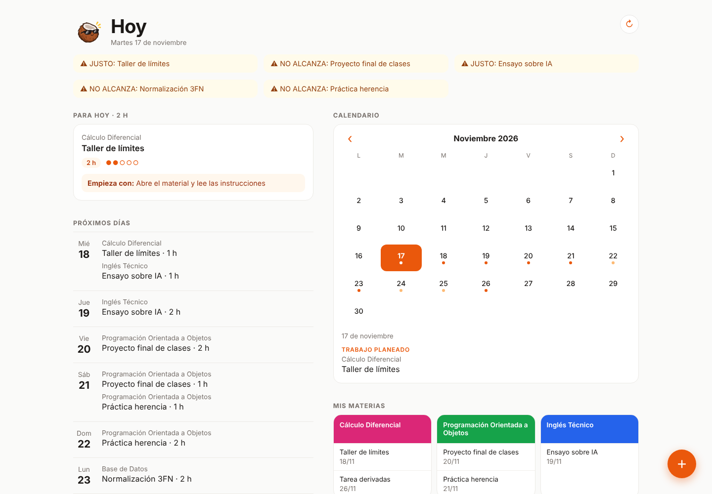
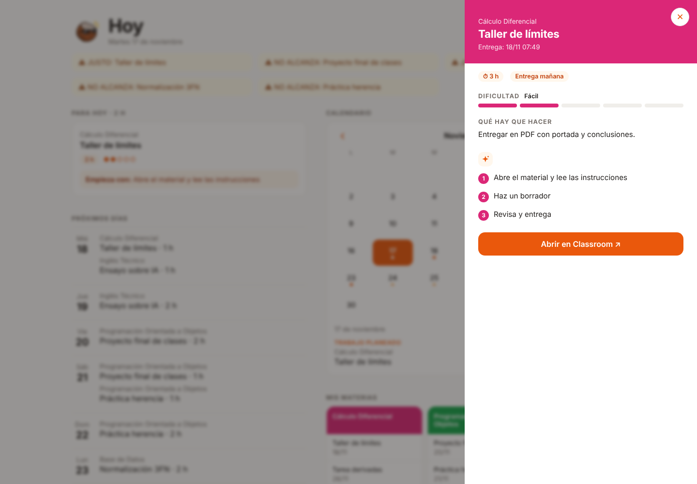
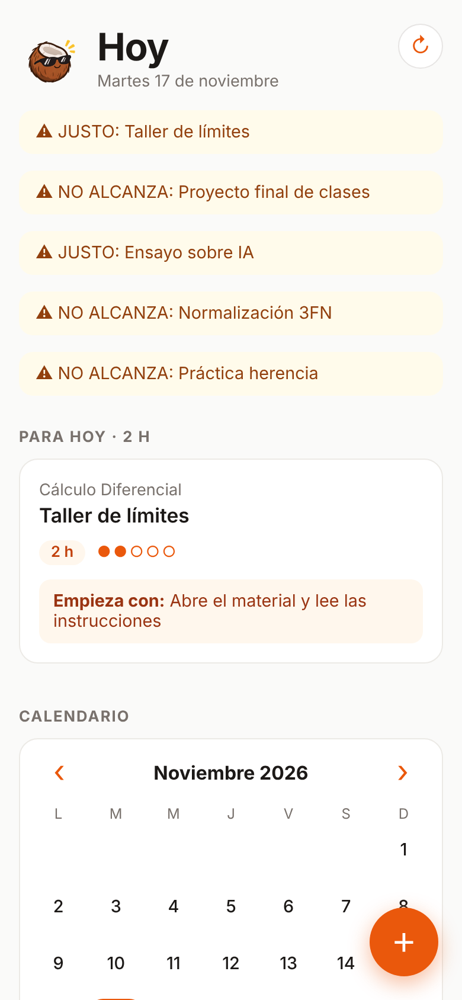
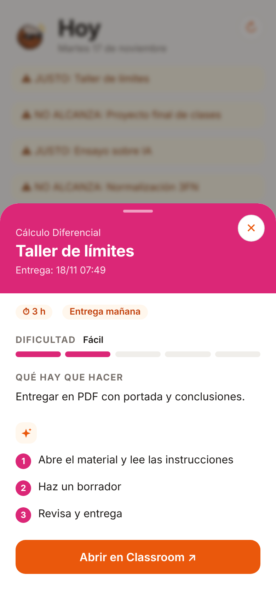

# 🥥 Coco Tareas

App personal contra la procrastinación. Se conecta a mi Google Classroom, usa IA (Gemini) para estimar cuánto tarda y qué tan difícil es cada tarea, arma un cronograma y me avisa por Telegram cuándo toca empezar.

## Capturas
Las capturas usan tareas de ejemplo.

**Computadora**

**Celular**

  
  

## Qué hace
- Lee mis tareas pendientes de Google Classroom (solo lectura).
- Analiza cada tarea con IA: horas estimadas, dificultad (1 a 5) y pasos para empezar.
- Construye un cronograma repartiendo las horas desde hoy, para no dejar todo al último día.
- Interfaz web que se adapta a celular y computadora: calendario, materias y detalle de cada tarea.
- Permite agregar tareas manuales (también las analiza la IA) y fechar o ignorar las que no tienen fecha.
- Avisos por Telegram: resumen del día, "ya toca empezar" según dificultad y tareas nuevas.

## Tecnologías
Python, Flask, SQLite, Google Classroom API, Gemini API, Telegram Bot API, HTML/CSS/JavaScript.

## Cómo correrla
1. Instalar dependencias: `pip install -r requirements.txt`
2. Crear en Google Cloud un cliente OAuth de escritorio y guardar su archivo como `credentials.json`.
3. Crear un archivo `.env` con `GEMINI_API_KEY`, `TELEGRAM_TOKEN` y `TELEGRAM_CHAT_ID`.
4. Iniciar sesión con Google: `python paso1_classroom.py`
5. Correr la app: `python app.py` y abrir `http://localhost:5000`

## Política de privacidad
Esta app es de uso personal y la usa una sola persona, su creador.
- Solo lee (no modifica) mis cursos y tareas de Google Classroom.
- Los datos se guardan únicamente en mi propio equipo o servidor y no se comparten ni se venden a nadie.
- No se recopilan datos de otros usuarios.
